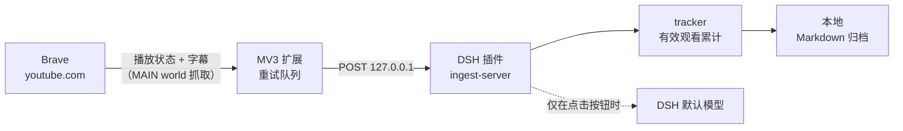

# dsh-youtube-archive

> **看了就归档。** Brave 里真正播放过的 YouTube 视频，自动变成一篇带字幕、译文、段落笔记和英文表达的本地 Markdown 笔记。

[](LICENSE)
[](#开发与测试)
[](#已知限制与路线图)
[](#安装)

它不是“又一个视频总结工具”。区别只有一句话：**别人是“我想总结这个视频”，你是“我看过，所以它已经在库里了”。**

- 纯本地：字幕、译文、笔记都在你的磁盘上，Markdown 文件归你所有。
- 手动才花钱：默认不调用模型；点「翻译字幕」或「生成总结」才产生 token。
- 长视频不截断：手动翻译按批推进，断了能接着翻，直到最后一块。
- 能抓登录态字幕：走播放器响应，会员/年龄限制视频也有字幕。

---

## 目录

- [它适合谁，不适合谁](#它适合谁不适合谁)
- [和现成工具的关系](#和现成工具的关系)
- [特性](#特性)
- [工作原理](#工作原理)
- [安装](#安装)
- [配置](#配置)
- [归档结构](#归档结构)
- [Token 与成本](#token-与成本)
- [隐私与合规](#隐私与合规)
- [已知限制与路线图](#已知限制与路线图)
- [开发与测试](#开发与测试)
- [License](#license)

---

## 它适合谁，不适合谁

**适合：**

- 每天在 YouTube 上学习，希望内容沉淀成可检索的本地知识库（Obsidian / Logseq / 纯文件）。
- 在意隐私：不想把公司内训、付费课程、会员视频的字幕上传到第三方服务。
- 在意成本：不想为“总结一个视频”付固定月费，愿意按 token 付费或接本地模型。
- 看长视频（30 分钟到 2 小时），需要完整字幕和分段笔记，而不是前 10 分钟的摘要。

**不适合：**

- 只想快速看懂一个视频 → 用 [BibiGPT](https://bibigpt.co) / [NoteGPT](https://notegpt.io)，装完就能用。
- 只需要双语字幕 → 用 [沉浸式翻译](https://immersivetranslate.com)，免费且更省事。
- 不用 DeepSeek Harness → **目前装不了**。插件运行在 DSH 的 host 进程里，这是当前最大的限制，脱钩在路线图里。
- 用 Chrome / Edge → 扩展结构通用，但只验证过 Brave。
- 依赖 macOS 系统级「实时字幕」→ 字幕渲染在系统层，网页 DOM 里没有，抓不到。

## 和现成工具的关系

| | BibiGPT / NoteGPT | 沉浸式翻译 | **本项目** |
| --- | --- | --- | --- |
| 触发方式 | 手动贴链接 | 打开页面即翻译 | **播放 45 秒自动入库** |
| 数据位置 | 厂商云端 | 本地渲染 + 云端翻译 | **全部本地** |
| 产物 | 网页 / PDF / 复制文本 | 双语页面 | **Markdown 目录树 + 索引** |
| 计费 | 订阅 | 免费 / 订阅 | **按 token，可接本地模型** |
| 长视频 | 有长度上限 | 不涉及 | **分块续翻，无总块数上限** |
| 登录态字幕 | 通常拿不到 | 不需要 | **走播放器响应可拿到** |

它们更好用，这是事实；这套东西存在的理由只有一个：**把“看过”变成“拥有”，并且不离开本机。**

## 特性

**归档**

- 以 `videoId` 去重：重播只更新观看统计，不产生第二篇笔记；分类变化时自动移动文件。
- 按「媒体时间」累计有效观看：暂停、拖动、静音且标签页隐藏都不计时，达到 45 秒才建笔记。
- 自动分类到 9 个内置分类，生成 `index.md` 总索引与 `daily/` 当日汇总。

**字幕**

- 有字幕轨：从播放器响应直接取完整轨道。
- 只有自动字幕：监听 CC 覆盖层逐段抓取，边播边增量上传，断句自动合并去重。
- 句子重建：合并逐词增长的碎片、去掉 `>>`/口吃重复、按标点与停顿重建成完整句子，保留 `[mm:ss]` 时间戳。

**笔记**

- 一句话总结、核心要点、知识结构、可回看时间点（带 `?t=` 跳转）、行动项、章节。
- 段落笔记：按时间切成 3~6 段，每段有起止时间、标题、要点。
- 常用英文表达：从英文字幕里提取真实出现的 4~8 个搭配，给中文释义、用法和例句。

**成本**

- 默认 **不自动总结、不自动翻译**；播放和抓字幕全程零模型调用。
- 总结与翻译都是笔记里的一个按钮，点之前会显示预估 token。
- 译文按块哈希缓存，字幕增长时只翻新增部分。

**浏览界面**

- 本机 `http://127.0.0.1:47821/` 提供只读 Web UI：分类侧栏、全文搜索、四页签详情（总结 / 段落 / 英文表达 / 字幕）。
- 支持「对照 / 原文 / 译文」切换和字幕搜索，深链接 `#note=<绝对路径>` 可直接打开某篇笔记。
- 界面不发任何外部请求，读取路径严格限制在归档目录内。

## 工作原理



扩展只做采集，插件只做本地处理，模型调用永远由你触发。

## 安装

**前置条件：** macOS、[Brave](https://brave.com)、已安装 DeepSeek Harness 桌面端。

### 1. 安装 DSH 插件

```bash
git clone https://github.com/Seeryu-5/dsh-youtube-archive.git
cd dsh-youtube-archive

# DSH CLI 的路径以你的安装位置为准
"/Applications/DeepSeek Harness.app/Contents/Resources/runtime/cli/bin/dsh" \
  plugin --profile desktop add "file:$PWD"
```

确认 `~/.dsh/profiles/desktop/package.json` 的 `dependencies` 与 `dsh.profile.bundles` 都包含 `dsh-youtube-archive`，然后**重启 DeepSeek Harness**（插件模块有缓存，不会热重载）。

重启后会出现三个工具：`youtube_archive_status` / `youtube_archive_summarize` / `youtube_archive_list`。

### 2. 加载 Brave 扩展

1. 打开 `brave://extensions`，开启右上角「开发者模式」。
2. 点「加载已解压的扩展程序」，选择仓库里的 `extension/` 目录。
3. 在扩展「详情 → 扩展程序选项」里点「测试连接」，应显示插件版本、端口和已归档数量。

> 该目录不能移动或删除；扩展是“已解压”方式加载的。改完扩展代码需要在 `brave://extensions` 里点刷新，并刷新 YouTube 标签页。

### 3. 验证

1. 在 DSH 里调用 `youtube_archive_status`，`Brave 扩展` 显示“已连接”。
2. 在 Brave 播放一个 YouTube 视频 ≥ 45 秒（非静音），约 30 秒内出现占位笔记。
3. 播放结束或暂停 1 分钟后，字幕写入笔记（此时**还没有总结和译文**）。
4. 打开 `http://127.0.0.1:47821/`，在「字幕」页签点「翻译字幕」，「总结」页签点「生成总结」。

完整的日常操作、排错、配置说明见 **[使用手册.md](使用手册.md)**。

## 配置

默认即可用。需要覆盖时，在 `~/.dsh/profiles/desktop/cordis.patch.yml` 追加：

```yaml
- id: dsh-youtube-archive
  config:
    outputDir: ~/Documents/YouTube知识库
    minWatchSeconds: 45
    port: 47821
```

| 配置 | 默认 | 说明 |
| --- | --- | --- |
| `enabled` | `true` | 总开关；关闭后不启动本地服务 |
| `port` | `47821` | 本地监听端口；被占用时自动试到 +9，并在 status / 扩展选项里显示实际端口 |
| `outputDir` | `~/Documents/YouTube知识库` | 归档根目录 |
| `minWatchSeconds` | `45` | 有效观看多少秒后建笔记 |
| `idleFinalizeMinutes` | `1` | 停止上报多久视为本次观看结束 |
| `autoSummary` | `false` | 是否在收尾时自动生成总结；默认关闭，改为手动点按钮 |
| `autoTranslate` | `false` | 是否自动翻译字幕；默认关闭 |
| `initialSummary` | `false` | 仅在 `autoSummary=true` 时生效：45 秒是否先做一次快速摘要 |
| `summaryLanguage` | `zh` | 总结语言 |
| `transcriptMaxChars` | `60000` | 送给模型的字幕上限（超出保留首尾） |
| `noteTranscriptMaxChars` | `24000` | 笔记里保留的字幕/译文长度上限 |
| `maxTokens` | `8000` | 单次输出上限（是上限，不是实际花费） |
| `reasoningEffort` | `low` | 推理强度，`low` 最省 token |
| `cleanTranscript` | `false` | 是否额外用模型把碎片字幕校对成完整句子 |
| `translationChunkChars` | `3000` | 翻译分块大小（越小越稳，调用次数更多） |
| `translationBatchChunks` | `2` | 每批翻译几块；不按总块数截断 |
| `skipLive` / `skipShorts` | `true` | 跳过直播 / Shorts |
| `skipMutedBackground` | `true` | 静音且标签页隐藏时不计时 |
| `provider` / `model` | `null` | `null` 表示跟随 DSH 默认模型；两者必须同时设置 |
| `categories` | 9 个内置分类 | 模型只能从中选一个归档分类 |

## 归档结构

```
~/Documents/YouTube知识库/
├── index.md                     # 总索引：分类统计 + 每个分类的表格
├── daily/2026-11-19.md          # 当日观看汇总
├── 教育与学习/
│   └── 2026-11-19-视频标题-abc123DEF45.md
├── AI与技术/
│   └── ...
└── .state/
    ├── state.json               # 视频状态、统计、笔记路径
    ├── sessions.jsonl           # 每次观看会话
    ├── transcripts/<id>.json    # 字幕缓存（可删）
    └── ingest.log               # 运行日志（不含字幕正文）
```

每篇笔记包含 YAML front matter（标题/频道/分类/标签/观看统计/总结状态/字幕状态/模型/token）以及一句话总结、核心要点、知识结构、时间戳、行动项、章节、简介、字幕译文、字幕原文与归档信息。

看一份完整的虚构样例：**[docs/sample-note.md](docs/sample-note.md)**。

## Token 与成本

- 播放、抓字幕、写索引、浏览界面：**0 次模型调用**。
- 建占位笔记：0 次模型调用。
- 收尾保存最新字幕：0 次模型调用（除非开了 `cleanTranscript`）。
- 只有「生成总结」和「翻译字幕」两个按钮会产生费用，点击前会显示预估 token。

参考量级（实际取决于字幕长度与模型）：

| 操作 | 9 分钟视频 | 1 小时视频 |
| --- | --- | --- |
| 生成总结 | 约 3.5k–5k token | 约 8k–12k token（字幕截断后） |
| 翻译字幕 | 约 6k–9k token | 约 40k–60k token（分多批） |
| 只看不点 | **0** | **0** |

`maxTokens` 是单次输出上限；`reasoningEffort: low` 能把推理开销压到最低。想更省：不点按钮，或把 `minWatchSeconds` 调大、`cleanTranscript` 保持关闭。

## 隐私与合规

- 本地服务只监听 `127.0.0.1`，要求 `X-DSH-Archive: 1` 请求头，拒绝网页 Origin，避免任意网站写入。
- 扩展只匹配 `https://www.youtube.com/*`，只向 `127.0.0.1` 发送标题、URL、播放进度和字幕，不发往任何外部服务。
- 总结和翻译会把标题/简介/字幕发给你在 DSH 里配置的模型提供方，这与普通对话一致；不想外发就不要点按钮。
- 本项目不下载视频、不绕过付费墙、不批量爬取；只处理你正在观看的页面上的字幕。**请自行确认使用方式符合 YouTube 服务条款与当地法律。**
- 详细说明见 [PRIVACY.md](PRIVACY.md)。

## 已知限制与路线图

**限制**

- 仅验证 Brave（Chromium 152）；扩展结构可复用到 Chrome/Edge，但未验收。
- 必须运行 DSH 桌面端；插件不能脱离 DSH 独立运行。
- 系统级「实时字幕」抓不到，必须用 YouTube 播放器自己的 CC。
- 自动字幕的断句与专有名词识别受 YouTube ASR 限制，句子重建只能减少碎句，不能保证 100% 准确。
- 字幕超过 `transcriptMaxChars` 时保留首尾并标注截断，总结质量会受影响。

**路线图（按优先级）**

- [ ] 脱钩 DSH：独立本地服务 + OpenAI 兼容客户端，支持 DeepSeek / Ollama / 任意 base_url。
- [ ] 一键安装包（菜单栏 App）与 Chrome Web Store 上架。
- [ ] Obsidian 双链与标签自动生成。
- [ ] 无声字幕视频的 Whisper 兜底（可选，默认关闭）。

## 开发与测试

```bash
# 跑测试（需要 Node 20+；DSH 自带的 Electron 也能当 Node 用）
node --test test/*.test.mjs

# 装完 DSH 插件后，把改动同步到插件目录并重启
./scripts/deploy-local.sh
```

- `test/` 覆盖配置校验、URL/文件名、观看累计、字幕解析、总结规范化、归档/索引、HTTP 鉴权与端口回退、手动总结/翻译、长视频分块续翻。
- `scripts/selftest.mjs` 用桩 LLM 跑完整链路：心跳 → 占位 → 字幕 → 收尾 → 重播去重。

```
dsh-youtube-archive/
├── lib/            # 插件 host 逻辑（采集、字幕、翻译、归档、本地 API）
├── web/            # 浏览界面（原生 HTML/CSS/JS，无构建）
├── extension/      # Brave MV3 扩展
├── test/           # node --test 测试
├── scripts/        # 本地部署与自测脚本
└── docs/           # 样例笔记等文档素材
```

欢迎 issue 和 PR。提交前请先跑通 `node --test test/*.test.mjs`。

## License

[MIT](LICENSE) © 2026 chenrumeng

---

**使用手册**：[使用手册.md](使用手册.md) · **English**：[README.en.md](README.en.md) · **更新记录**：[CHANGELOG.md](CHANGELOG.md)
